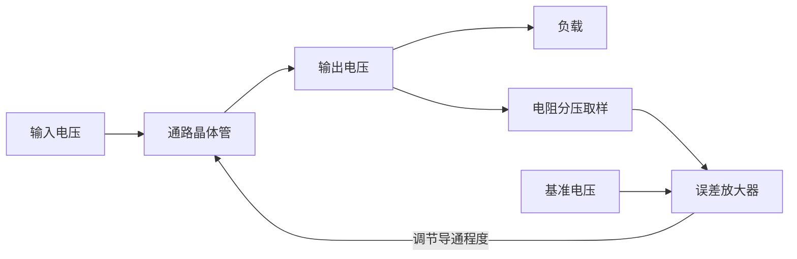

# LDO 与 Buck 选型

日期：2026-11-22

## 概念与英文术语

- **LDO（Low-Dropout Regulator，低压差线性稳压器）**把较高的电压降到目标值。它的输入电流约等于负载电流，多出来的电压对应的功率主要变成热。
- **Buck（降压型开关稳压器）**通过快速开关和电感、电容给负载供电。压差大、电流大时通常更省电，但要看输出的纹波，也就是叠在直流电压上的周期性小起伏。

## 工作原理与适用条件

先问稳压器输入端实际最低和最高各是多少伏，再问负载需要多少伏。输入低于目标时，这两种降压方案都无法把电压抬上去。输入略高于目标时，LDO 要核对数据手册里的最小工作压差（dropout voltage），并按负载电流和温度留出余量。Buck 也要核对器件在最低输入时是否能维持目标输出。

两种方案都能稳压时，再比较负载电流、效率、发热和噪声。效率是送给负载的功率占输入功率的比例。要求供电安静的小电流模拟电路可以考虑低噪声 LDO。压差大且电流大的核心电源通常优先考虑 Buck。

| 教学场景 | 假设输入与负载 | 选型与原因 |
| --- | --- | --- |
| 传感器的模拟电路 | 输入 2.0–2.2 V，目标 1.8 V，负载 10 mA。假设所需最小压差为 0.10 V。 | 最低输入仍有 0.20 V 压差，可考虑低噪声 LDO。输入为 2.1 V 时，忽略芯片自身消耗，损耗约为 (2.1 − 1.8) V × 0.010 A = 3 mW。 |
| 手机处理器核心 | 输入 3.4–4.2 V，目标 0.9 V，负载示例为 2 A。 | 输入为 3.8 V 时，用 LDO 的估算损耗为 (3.8 − 0.9) V × 2 A = 5.8 W，通常优先考虑能满足电流和输出要求的 Buck。 |

LDO 损耗来自高中物理的功率关系。若输入、输出电流近似相同，输入功率减去输出功率，约等于输入与输出的电压差乘以负载电流。例题中的数字是假设，具体限值看被选器件的数据手册。

### LDO 的内部结构与反馈

![[LDO 3D 功能示意图.png]]

这是功能示意图。以固定输出 LDO 为例，取样电阻可以集成在芯片里，有些可调型号会把取样电阻接在芯片外。图中的电压与分压比例用于理解，器件内部参数以厂家公开资料为准。

#### 把一次稳压过程走完

1. **上电。** 输入有效，且使能端允许工作后，内部基准电压建立。刚开始输出较低，取样也低。控制电路提高通路晶体管的导通程度，给输出电容充电并向负载送电。具体启动速度由器件设计和外接电路决定。
2. **稳住。** 假设输出取三分之一与 0.60 V 基准比较。输出接近 1.80 V 时，取样与基准接近，通路晶体管保持在足以供给当前负载的位置。负载变大时，晶体管会建立新的导通程度。
3. **负载突然变大。** 输出电容先补上暂时多出来的电流，电容放电时输出电压下降。若输出从 1.80 V 降到 1.77 V，取样就从 0.60 V 降到 0.59 V。误差放大器让晶体管更导通，补上电流，输出回到目标附近。负载突然变小时方向相反，输出可能先升高，反馈随后让晶体管少导通。
4. **输入太低。** 输出偏低时，反馈会要求通路晶体管继续增加导通。一旦它已尽量导通，剩下的电压损失仍与电流和导通电阻有关，可粗略理解为电流乘导通电阻。继续降低输入时，输出会随输入下滑。最小工作压差会随负载和温度变化。
5. **触发保护。** 使能（EN，Enable）控制是否工作，欠压锁定负责在输入过低时关闭或阻止启动。过流时限流电路接管，温度过高时过温保护可能关断输出。具体门槛及恢复方式看所选器件。

「线性」描述通路晶体管调节导通程度的方式。若输入 2.1 V、输出 1.8 V、负载 10 mA，晶体管承担约 0.30 V 压降，损耗约 3 mW。优先考虑低噪声 LDO 的场景包括小电流的传感器模拟电源，前提是最低输入压差够、最大负载和温升都满足要求。[德州仪器 TPS7A20 数据手册，第 6 节](https://www.ti.com/lit/ds/symlink/tps7a20.pdf#page=23)

典型 LDO 有一条给负载送电的主路径，还有一条根据输出调节通路晶体管的反馈路径。



- **通路晶体管（pass transistor）**串在输入和输出之间，主负载电流从这里流过。误差放大器连续调节它的栅极，控制输出电压。
- **基准电压（reference voltage）**提供比较用的稳定电压，常由芯片内的带隙基准电路产生。
- **反馈（feedback）**把输出电压按比例缩小后送回来。典型做法是用两个电阻分压。假设取样是输出的三分之一，输出为 1.8 V 时，取样就是 0.6 V。
- **误差放大器（error amplifier）**比较取样和基准，再控制通路晶体管。输出偏低就让晶体管更导通，输出偏高就让它少导通。这叫负反馈，因为调节的方向会抵消原来的偏差。

很多器件还有使能、限流或过温保护。输出端通常按手册接电容，它能在负载突然增大时短暂补电，也会影响稳压是否稳定。负载、压差和温度在规格允许的范围内时，这套电路才能正常调节。晶体管即使已经尽量导通，也需要留出一定压差，这与前面的最小工作压差有关。[德州仪器 LDO 功能框图](https://www.ti.com/lit/ta/sszt658/sszt658.pdf)

如果传感器供电需要低噪声，且最低输入留有足够压差、负载电流和发热符合要求，可以考虑低噪声 LDO。用已按手册接好输出电容的测试板固定输入，在规定范围内把负载电流从小突然调大，用示波器测输出端对地电压，观察输出先掉了多少、多久回到允许范围。这个测试叫负载瞬态测试，阶跃大小、变化速度和判定限值以器件规格或测试要求为准。[德州仪器 LDO 负载瞬态说明](https://www.ti.com/lit/an/slyt151/slyt151.pdf)

#### 深入到通路晶体管的三个引脚

用一种常见的正电压 PMOS LDO 学习。PMOS（P-channel Metal-Oxide-Semiconductor Field-Effect Transistor，P 沟道金属氧化物半导体场效应晶体管）有源极 S、漏极 D、栅极 G。这个例子里的源极接输入，漏极接输出，栅极接误差放大器的驱动。输入和输出的外部电源、负载共用电路地。

```text
VIN ── S [ PMOS ] D ──● VOUT ──┬── 负载 ── 地
            G ↑       │        └── COUT ── 地
           栅极驱动    └── R1 ──● VFB ── R2 ── 地
                               │
                     VREF 与 VFB 送去比较
```

栅极与沟道之间隔着绝缘层。改变栅极电压产生的电场会改变沟道的导通程度，给负载送电的主电流从 S 流向 D。驱动器要给栅极充放电才能改变栅极电压，栅极不承担给负载供电的持续电流。在源极电压固定时，降低栅极电压会增大源极与栅极的电压差 VSG = VS − VG，让这个 PMOS 更容易导通。提高栅极电压，让它更接近源极，方向相反。

分压电阻 R1 在上、R2 在下，因此 VFB = VOUT × R2 / (R1 + R2)。如果 R1 是 R2 的两倍，VFB 就是 VOUT 的三分之一。稳压时，负反馈让 VFB 接近 VREF。如果 VREF 是 0.60 V，VOUT 就接近 1.80 V。换分压比例就能换输出目标。图只演示一种 PMOS 实现，真实器件的栅极驱动、基准值和保护由厂家设计。

**从 10 mA 跳到 20 mA 时发生什么。** 输入保持不变。负载刚变化时，通路电流还来不及跟上，输出电容暂时补约 10 mA。若有效电容为 1 µF，且把这段电流差近似保持 1 µs，只算电容放电，输出大约下降 10 mV（ΔV = ΔI × Δt / C）。输出一降，VFB 也随之下降。驱动器把栅极电压拉低，PMOS 送来更多电流。通路电流超过当时的负载和取样支路需求时，多余电流给电容充电，输出回升。最终通路电流接近新的负载需求，电容不再持续充放电。这里的数值只演示电荷怎么变化，实际掉压还受电容、布线、负载变化速度和反馈速度影响。

**输入下降时。** 在相同负载下，输入与输出之间剩的压差越来越小，反馈会驱动晶体管导通得更强。当驱动已经到极限，剩余压降可近似理解为负载电流乘以晶体管的导通电阻。这时继续减小输入，输出也会下滑。这个现象就是压差测试在找的边界。测负载瞬态时固定输入，用示波器同时看输出和负载电流或触发。测压差时固定负载，慢慢降低输入并同时读输入、输出。具体条件见 [[LDO 测试流程与指标]]。

- [德州仪器 PMOS LDO 工作原理，图 6–7](https://www.ti.com/lit/an/slva068a/slva068a.pdf#page=5)
- [德州仪器 LDO 负载瞬态说明](https://www.ti.com/lit/an/slyt151/slyt151.pdf)

#### 研读博客园后的电路推导

从两只电阻分压想起。电阻分压接上传感器后，传感器电流改变下方电阻的等效阻值，输出也会变。LDO 用通路晶体管承担负载电流，分压支路只报告输出电压，再由误差放大器调节晶体管。

对前面画出的 PMOS 电路，R1 接 VOUT 与 VFB 之间，R2 接 VFB 与地之间。忽略误差放大器输入电流时，分压支路电流为 VOUT/(R1+R2)，所以 VFB=VOUT×R2/(R1+R2)。环路有足够增益且没有碰到压差、限流边界时，VFB 接近 VREF，因此 VOUT≈VREF×(1+R1/R2)。实际误差还来自基准、电阻比和误差放大器，需要用器件的输出精度规格判定。

“线性稳压器”描述连续调节的串联供电方式，不能据此断言 PMOS 在所有条件下都处于某一个晶体管工作区。输入逼近目标时，误差放大器继续要求晶体管增加导通。栅极驱动达到极限后，可用导通电阻近似压降，VDO≈IOUT×RDS(on)。继续降低 VIN，VOUT 会跟着下降，先前 VFB≈VREF 的调节前提已经失效。具体压差判据按照器件手册定义。

输出电容在负载突然增大时先补电流。它的等效串联电阻带来额外的电压跳变。误差放大器输出、PMOS 栅极和输出电容都有响应时间，因此电容和负载也会影响环路稳定性。博客园的进阶文章建立了误差放大器输出节点和 LDO 输出节点两个极点的模型，可用来进一步推导频率响应。

这些结论针对 PMOS 教学模型。基准、栅极驱动和保护电路的具体实现随器件变化。博客文章提供推导思路，工作区和选型条件依据芯片厂商资料核对。

- [博客园《低压差线性电源设计（LDO）》](https://www.cnblogs.com/mahaidong/p/16185622.html)
- [博客园《LDO（线性稳压器）-理论篇》](https://www.cnblogs.com/zhuzhuchang/p/19225029)
- [博客园《模拟集成电路设计系列博客——低压降稳压器》](https://www.cnblogs.com/sasasatori/p/17830546.html)
- [TI《PMOS LDO 基本理论》](https://www.ti.com/lit/an/slva068a/slva068a.pdf)

#### 用负载阶跃读懂电容和反馈环路

以 1.80 V 的 PMOS LDO 为例，把输出端看成一个电流汇合点。在忽略分压支路电流变化的简化模型中，电容的充放电电流等于通路晶体管供出的电流减去负载取走的电流。负载先多取的那部分电流，由电容补上。

- **最初的快速变化。** ESR（Equivalent Series Resistance，等效串联电阻）会产生约 ΔI × ESR 的电压下降。ESL（Equivalent Series Inductance，等效串联电感）、布线电感和探头接地也能产生很窄的尖峰，不能把尖峰全算成 ESR。
- **随后的一段下斜。** 在晶体管电流尚无明显变化的时间内，斜率大小约为 ΔI / Ceff。Ceff 是电容处在实际直流偏压和温度下的有效容量。
- **回升和振铃。** 误差放大器需要给 PMOS 栅极充放电。栅极电压、通路电流以及输出电容电压的变化都有时间尺度。反馈追回误差时可能产生几次衰减的上下摆动，这叫振铃。实际波形还要排查输入电源掉压、电子负载的响应和探测连接。

教学算例在固定输入下把负载从 10 mA 跳到 50 mA，假设早期约 2 µs 内仍短缺 40 mA，跳变足够快，Ceff = 1.0 µF、ESR = 50 mΩ。ESR 项约为 2 mV，电容项约为 80 mV，估算总下跌约 82 mV。若项目只允许跌 50 mV，给电容放电留的预算只有 48 mV，按此模型所需有效容量约为 1.67 µF。必须再查器件对电容量和 ESR 的要求，按相同输入、负载阶跃和接线复测。换电容也会改变反馈响应，2 µs 只是算例假设。

**从小信号看稳定性。** 围绕同一工作点施加小扰动时，反馈环路依次把输出变化转换成取样电压差、栅极电压变化、通路电流变化和新的输出电压变化。环路增益描述扰动沿这条链走一圈的放大倍数和相位变化。常用的负反馈符号约定下，在环路增益幅值等于 1（0 dB）的位置，离 −180° 还有多少角度，就是相位裕度。例如相位为 −135° 时，裕度为 45°。输出电容、负载和晶体管栅极都会影响环路。振铃可以作为排查线索，单凭一条波形无法读出准确的相位裕度。

**台架上的对照。** 用相同的输入和实测电流阶跃，记录负载阶跃前后的电流、VOUT 最小值、最初下斜的速度、恢复时间以及是否振铃。可用两种满足手册要求的输出电容重复同一条件，并同时监视 VIN。通过条件由项目规范和实际测量给出。参见 [[LDO 测试流程与指标]]。

- [德州仪器 LDO 负载瞬态说明](https://www.ti.com/lit/an/slyt151/slyt151.pdf)
- [德州仪器 PMOS LDO 稳定性分析](https://www.ti.com/lit/an/slyt194/slyt194.pdf)

## 在测试中的用途

完整台架流程、测试条件和判定算例见 [[LDO 测试流程与指标]]。

- **最低输入时能否稳压。** 在规定负载下，把稳压器输入调到假设范围的最低值。以板上参考地为基准，用万用表测稳压器实际输入端和负载电源轨。观察输出还能否保持在规定范围。
- **高输入和大负载时是否过热。** 在器件允许的范围内，用最高输入和最大预期持续负载检查温升。对 Buck 可测输入、输出两边的电压和电流，计算两边功率和效率。
- **供电是否平稳。** 在相同输入和负载下，用示波器看负载端电源轨的小幅波动，按适用规格要求的测量条件和限值判断。真实读数和波形记入 [[实验记录]]。

### 自测复习

题目给的是最低输入 1.90 V。此时可用压差为 1.90 V − 1.80 V = 0.10 V，小于当前负载所需的 0.15 V，因此不能保证整个输入范围内都稳在 1.80 V。按题设计算，满足压差要求的输入下限为 1.80 V + 0.15 V = 1.95 V。输入降到 1.90 V 时的实际输出要看器件和负载，可以在题设负载下测输出端对参考地的电压。

## 资料与待确认问题

实际设计要确认输入范围、负载电流及温度范围、输出电压允许偏差、纹波和噪声限值。

- [德州仪器 LDO 参数与损耗说明](https://www.ti.com/lit/ml/slvt150/slvt150.pdf)
- [德州仪器稳压效率、发热与噪声对比](https://www.ti.com/document-viewer/lit/html/sbva099)
