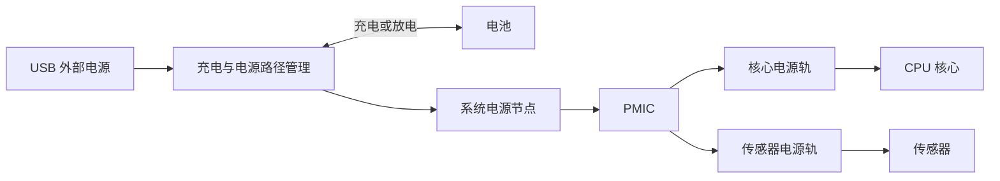

# 芯片供电测试地图

## 手机的供电路径

以下框图假设手机采用带电源路径管理的架构，分别画出功能和电流方向。具体手机的芯片分工和测点以原理图及器件资料为准。

| 术语 | 在框图中的作用 |
| --- | --- |
| USB（Universal Serial Bus，通用串行总线） | 图中指通过接口接入的外部电源。 |
| 电源路径管理（power-path management） | 管理外部输入、电池和系统之间的供电路径。充电功能控制电池充电电流和电压。 |
| 系统电源节点 | 给下游稳压电路供电的上游节点。图中将它画为 PMIC 的输入。 |
| PMIC（Power Management Integrated Circuit，电源管理集成电路） | 将上游电源转换成多个负载所需的电压。 |
| 电源轨（power rail）与负载（load） | 电源轨把一路供电分配给用电电路。CPU（Central Processing Unit，中央处理器）核心和传感器是不同的负载。 |
| SoC（System on Chip，片上系统）与供电域 | 一颗 SoC 可包含多个分别供电的电路区域。上图的核心电源轨只展示其中一路。 |
| Buck（降压型开关稳压器） | 可用于产生低于其实际输入电压的一路电源。 |

### 插线与拔线

- **插线且外部输入有效时**，外部电源经电源路径管理送到系统电源节点，再经 PMIC 的各路稳压给核心与传感器供电。充电条件满足且输入有余量时，另一路电流进入电池。若外部输入受限，带电池补电功能的方案可降低充电电流，并在需要时由电池补足系统电流。
- **拔线且电池可正常放电时**，电池经电源路径管理接管系统电源节点，再由 PMIC 向核心与传感器供电。

### 怎么测

在电池已接入且可放电的条件下，分别在处理器空闲和可重复的高负载下做插拔，记录外部电源条件、电池端电压和负载状态。以板上参考地为基准，用示波器观察外部输入、系统电源节点和可访问的负载电源轨。拔线时可用外部输入电压的下降沿触发，记录系统节点和电源轨的最低电压、偏离的持续时间及是否发生复位。通道不足时先看系统节点和核心电源轨，再用相同条件复测传感器电源轨。

如果要确认插线时电池究竟在充电还是放电，按已知的正负方向测量电池支路电流。待确认项包括实际测点、负载允许电压范围和瞬态判据。框图和测试场景是教学假设，限值取自对应器件或整机规格，实测结果再记入 [[实验记录]]。

器件参考见德州仪器 BQ2407x 数据手册第 9.3.4 节，其中给出了外部输入供电、电池补电和仅电池供电的实例。[BQ2407x 数据手册](https://www.ti.com/lit/ds/symlink/bq24074.pdf#page=21)

## 常见测试术语

| 听到的术语 | 测试方向 | 可以怎么追问 |
| --- | --- | --- |
| 输出电压、纹波（ripple） | 稳态供电 | 哪一路？输入和负载是什么条件？ |
| Droop（电压下跌）、过冲、负载瞬态 | 动态响应 | 负载怎么变的？电压偏离多大，多久恢复？ |
| Enable（使能信号）、Power Good（电源正常指示） | 上下电时序 | 哪些信号或电源轨之间有时间要求？ |
| 待机电流、功耗、效率 | 能耗 | 当时是什么运行状态？测的是哪一端？ |
| 欠压锁定、限流、过温保护 | 异常与保护 | 什么条件触发？解除后怎样恢复？ |

例子：听到「CPU 一加负载，核心电压掉了一下」，先定位到核心电源轨和负载瞬态，再问测点、下跌幅度、持续时间及规格。术语和现象可以先记下来，原因留到看过测量条件和波形后再判断。
